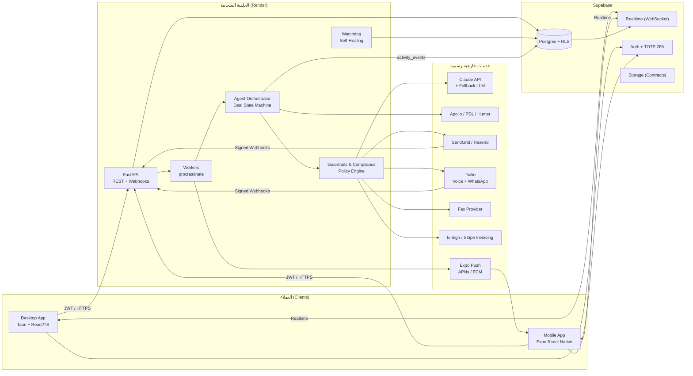
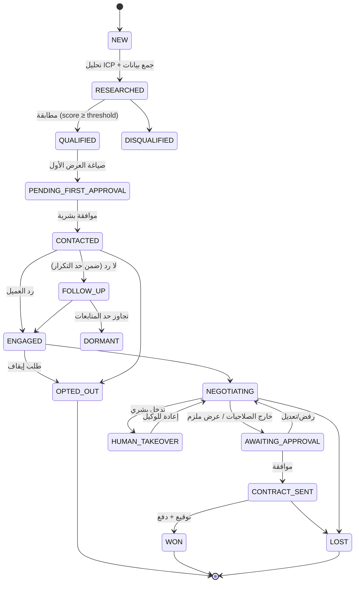
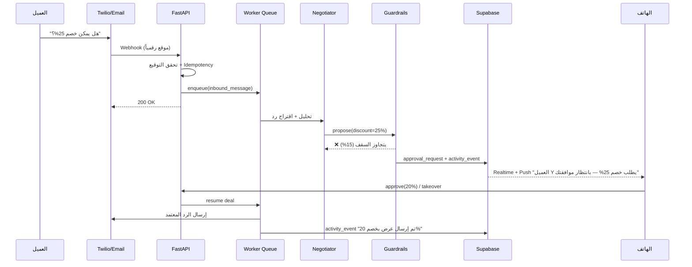
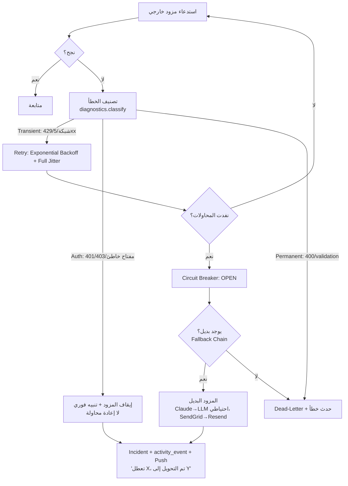
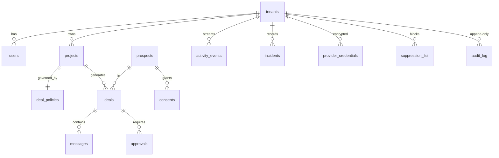

# SalesBrain — المخطط المعماري وهيكلة المشروع

> **الحالة:** المرحلة 1 (Architecture) + المرحلة 2 (Directory Structure) — وثيقة تصميم، لا تحتوي كوداً تنفيذياً بعد.
> **النطاق:** منظومة مبيعات ذاتية (Autonomous AI Sales & Deal-Closing Ecosystem) — خلفية Python سحابية، تطبيق سطح مكتب، تطبيق هاتف، مزامنة لحظية.

---

## 0. قرارات هندسية حاسمة (يجب اعتمادها قبل الكتابة)

| # | القرار | البديل المرفوض | السبب |
|---|--------|----------------|-------|
| D1 | **الخلفية (FastAPI) تعمل سحابياً 24/7** وتطبيق سطح المكتب «لوحة تحكم» وليس محرك التشغيل | تشغيل محرك Python محلياً على الحاسوب | Webhooks الخاصة بـ Twilio/WhatsApp/Email تحتاج عنواناً عاماً بـ HTTPS يعمل دائماً؛ إغلاق الحاسوب يعني ضياع ردود العملاء. يدعم المستودع أصلاً Render. |
| D2 | **Tauri 2 + React + TypeScript** لسطح المكتب | Electron | حجم أصغر بنحو 10×، صلاحيات نظام مقيدة (capabilities)، تحديثات موقعة مدمجة. |
| D3 | **React Native (Expo)** للهاتف | Flutter | مشاركة الأنواع، عميل الـ API، الترجمة (ar/en) ورموز التصميم مع سطح المكتب عبر حزم TypeScript مشتركة. |
| D4 | **Supabase** (Postgres + Auth + Realtime + Storage + RLS) | Firebase | بيانات CRM علائقية (صفقات/عملاء/رسائل)، SQL، عزل صارم عبر Row-Level Security، و 2FA (TOTP) مدمج. |
| D5 | **Supabase Realtime** (وهو WebSocket) كقناة لحظية وحيدة؛ الخلفية تكتب في جدول `activity_events` والعملاء يستمعون | خادم WebSocket منفصل | مصدر حقيقة واحد ودائم؛ لا يضيع حدث إذا كان الهاتف غير متصل؛ مكوّن بنية تحتية أقل. |
| D6 | **آلة حالة صريحة للصفقة (Deal State Machine) + طبقة LLM مجردة** (Claude أساسي + مزود احتياطي) | CrewAI / LangChain | منطق المبيعات تسلسل حالات قابل للتدقيق؛ الأطر الثقيلة تُخفي التحكم وتضيف اعتماديات. الذكاء الاصطناعي يقترح، والسياسة البرمجية تقرر. |
| D7 | **طابور مهام على Postgres** (`procrastinate`) | Redis + Celery | لا خادم إضافي، مهام دائمة (durable)، تكرار موثوق، Dead-Letter. |
| D8 | **مصادر بيانات مرخصة فقط** (Apollo.io / People Data Labs / Hunter للتحقق) | Scraping لـ LinkedIn أو المواقع | مخالف لشروط الخدمة ويعرّضك لمسؤولية GDPR؛ مصدر كل جهة اتصال يُسجل (Data Provenance). |
| D9 | **ملفات صغيرة متخصصة** بدل ملف ضخم مثل `ai_sales_agent.py` | ملف أحادي (Monolith) | الملف الأحادي غير قابل للاختبار أو الصيانة. المكافئ هنا: `agents/orchestrator.py` + `healing/watchdog.py` + الوحدات المرتبطة. |

### تصحيحات لافتراضات في المتطلبات (مهمة قانونياً وتقنياً)

1. **الفاكس عبر Twilio غير متاح** — أوقفت Twilio خدمة Programmable Fax نهائياً. الحل: محوّل (Adapter) لمزود فاكس متخصص (مثل Documo mFax أو Sinch Fax API)، ويُستخدم **فقط لإرسال مستندات لطرف قائم في صفقة**. الفاكس الإعلاني غير المطلوب محظور (US JFPA).
2. **المكالمات الصوتية بالذكاء الاصطناعي للعملاء الباردين (Cold AI Calls) غير قانونية في الولايات المتحدة** دون موافقة خطية مسبقة (قرار FCC فبراير 2024 يعتبر الصوت المولّد «صوتاً اصطناعياً» تحت TCPA). وفي الاتحاد الأوروبي تختلف القواعد بين الدول. القرار: المكالمات الصوتية الذكية **فقط لمن لديه موافقة مسجلة أو طلب اتصالاً**.
3. **WhatsApp Business** لا يسمح ببدء محادثة إلا **بقالب معتمد من Meta ولمستخدم أعطى Opt-in**. لا يصلح كقناة تواصل بارد.
4. **«إغلاق الصفقة وتوقيع العقود ذاتياً»**: الوكيل لا يوقّع أبداً نيابة عنك. يجهّز العقد/الفاتورة، والإرسال الملزم يمر عبر بوابة موافقة بشرية (HITL) — انظر §4.
5. **«التعافي الذاتي»** يعني التعافي من أعطال تشغيلية معروفة (شبكة، مزود، حدود معدل، مفاتيح منتهية) وليس إصلاح أخطاء الكود ذاتياً. الأخطاء البرمجية تُكتشف وتُعزل وتُبلَّغ.

---

## 1. المخطط المعماري (System Architecture)

### 1.1 الرؤية العامة



**المبدأ الأساسي:** كل فعل يقوم به الوكيل يمر عبر **Policy Engine** قبل أن يلمس العالم الخارجي، ثم يُسجَّل كحدث في `activity_events` الذي يبثه Realtime للهاتف وسطح المكتب.

### 1.2 دورة حياة الصفقة (Deal State Machine)



- الانتقالات **محددة برمجياً**؛ الـ LLM يقترح الانتقال، والآلة ترفض أي انتقال غير مسموح.
- `OPTED_OUT` نهائي ويضيف العميل فوراً إلى `suppression_list` عبر كل القنوات.

### 1.3 وكلاء الذكاء الاصطناعي (Agents)

| الوكيل | المدخل | المخرج | النموذج |
|--------|--------|--------|---------|
| `icp_analyst` | بطاقة المشروع (Project Brief) | ICP منظم (قطاع، حجم، منطقة، أدوار القرار، إشارات الشراء) | نموذج عالي القدرة |
| `prospector` | ICP | مرشحون من مصادر مرخصة + `source` لكل سجل | لا LLM (API فقط) |
| `matcher` | ICP + مرشح | درجة مطابقة + مبررات | نموذج سريع |
| `pitch_writer` | Brief + مرشح | عرض مخصص لكل قناة (ar/en) | نموذج عالي القدرة |
| `channel_selector` | مرشح + سجل الموافقات | القناة المسموحة الأنسب | **قواعد صارمة أولاً**، ثم ترتيب ذكي |
| `negotiator` | المحادثة + Guardrails | رد + إجراء مقترح (خصم، شروط) | نموذج عالي القدرة |
| `closer` | صفقة متفق عليها | مسودة عقد/فاتورة → بوابة موافقة | قوالب + LLM للتخصيص |

**مخرجات كل وكيل منظمة (JSON Schema عبر Pydantic) ويُتحقق منها** — أي مخرج غير صالح يُرفض ويُعاد توليده أو يُصعَّد.

### 1.4 تدفق رسالة واردة (مثال: العميل يطلب خصماً)



---

## 2. الحدود والقواعد الصارمة (Guardrails) — جزء من النواة

### 2.1 سياسة الصلاحيات لكل مشروع (`deal_policy`)

| الحقل | المعنى | مثال |
|-------|--------|------|
| `list_price` / `price_floor` | السعر المعلن والحد الأدنى المطلق | 10,000 / 8,000 |
| `max_auto_discount_pct` | أقصى خصم يمنحه الوكيل دون إذن | 10% |
| `allowed_payment_terms` | شروط الدفع المسموحة | `["upfront", "net_15", "50_50"]` |
| `approval_deal_value_above` | أي صفقة أعلى من هذه القيمة تحتاج موافقة | 25,000 |
| `require_approval_first_message` | موافقة على أول رسالة لكل حملة/عميل | `true` (افتراضي) |
| `require_approval_binding_offer` | موافقة قبل أي عرض ملزم | `true` (**غير قابل للتعطيل**) |
| `require_approval_contract` | موافقة قبل العقد/الفاتورة | `true` (**غير قابل للتعطيل**) |
| `max_touches_per_prospect` | أقصى عدد رسائل متابعة دون رد | 3 |
| `min_hours_between_touches` | فاصل أدنى بين الرسائل | 72 |
| `quiet_hours` | ساعات يُمنع فيها التواصل (بتوقيت العميل) | 20:00–09:00 |

**التنفيذ:** `compliance/guardrails.py` دالة حتمية (Deterministic) تستقبل `ProposedAction` وتعيد `ALLOW | REQUIRE_APPROVAL | DENY` مع السبب. **الـ LLM لا يستطيع تجاوزها** — حتى لو حاول العميل التلاعب بالتعليمات (Prompt Injection)، لأن القرار خارج النموذج.

### 2.2 حماية السمعة القانونية

- **التعريف الإلزامي:** كل رسالة أولى تتضمن: هوية المرسل (الشركة)، أنه مساعد ذكي يعمل نيابة عنها (AI Disclosure)، مصدر البيانات («حصلنا على بريدك المهني من Apollo.io»)، ورابط/طريقة إلغاء الاشتراك.
- **CAN-SPAM:** عنوان بريدي فعلي، سطر موضوع غير مضلل، تنفيذ إلغاء الاشتراك فوراً.
- **GDPR:** أساس قانوني مسجل لكل جهة اتصال (Legitimate Interest Assessment للـ B2B)، حق الحذف (Erasure Endpoint)، تقليل البيانات، مدة احتفاظ محددة.
- **مصفوفة القنوات:**

| القناة | الشرط القانوني للتواصل الأول |
|--------|------------------------------|
| Email | B2B مع Legitimate Interest + إلغاء اشتراك (يختلف حسب الدولة؛ ألمانيا تتطلب موافقة) |
| WhatsApp | Opt-in مسجل + قالب معتمد من Meta |
| Voice AI | موافقة صريحة مسجلة (Prior Express Written Consent) |
| Fax | طرف قائم في صفقة فقط — لا إعلانات |

- **سجل تدقيق غير قابل للتعديل** (`audit_log` append-only) لكل رسالة وقرار وموافقة.

---

## 3. فصل بيئة الاختبار عن الإنتاج (Sandbox vs. Live)

| الوضع | السلوك |
|-------|--------|
| `APP_MODE=sandbox` (**افتراضي**) | كل الإرسال الصادر يُعاد توجيهه إلزامياً إلى قائمة مستلمين مسموحة (`SANDBOX_ALLOWED_RECIPIENTS`: بريدك ورقمك). أي مستلم آخر ← `DENY` ويُسجل. مزودات البيانات تعمل بوضع Mock. Twilio Test Credentials حيث ينطبق. |
| `APP_MODE=live` | يتطلب: تفعيل صريح من الإعدادات + 2FA + اكتمال بطاقة المشروع + اجتياز فحص الاتصال بكل مزود. يبقى `require_approval_first_message=true` حتى تعطيله يدوياً. |

- مشروع Supabase **منفصل** لكل بيئة، ومفاتيح مزودين **منفصلة**.
- شارة واضحة دائمة في الواجهات: 🟡 **SANDBOX** / 🟢 **LIVE**.

---

## 4. التدخل البشري (Human-in-the-Loop)

- **Approval Requests:** جدول `approvals` بحالة `pending/approved/rejected/edited` ومهلة انتهاء. الصفقة تتوقف (Paused) حتى الرد.
- **Takeover:** زر واحد ينقل الصفقة إلى `HUMAN_TAKEOVER`؛ الوكيل يتوقف عن الرد في تلك المحادثة فوراً (Lock على مستوى قاعدة البيانات)، والمستخدم يرد من التطبيق مباشرة.
- **Kill Switch عام:** إيقاف كل الإرسال الصادر لكل المشاريع بضغطة واحدة.

---

## 5. المراقبة الذاتية والتعافي (Self-Healing)



- **Watchdog** (مهمة دورية كل 60 ثانية): فحص صحة قاعدة البيانات، الطابور (عمق/مهام عالقة)، كل مزود (Health Probe خفيف)، وصلاحية المفاتيح. المهام العالقة تُعاد جدولتها.
- **Idempotency Keys** لكل إرسال صادر — إعادة المحاولة لا تنتج رسالة مكررة للعميل.
- **Incidents:** جدول `incidents` (السبب، التشخيص، الإجراء المتخذ، الحالة)، يُعرض في الواجهة ويُرسل للهاتف.
- **اختبار الفوضى (Chaos Tests):** اختبارات آلية تحقن: انقطاع الشبكة، مفتاح خاطئ، 429، 500، Timeout — وتتحقق من: التقاط الخطأ، تطبيق البديل، إنشاء Incident، وإصدار إشعار.

### التحديثات الآمنة (OTA)

| المكوّن | الآلية |
|---------|--------|
| Desktop | Tauri Updater — حزم موقعة Ed25519، رفض أي حزمة غير موقعة |
| Mobile | EAS Update مع Code Signing (تحديثات JS فقط؛ التغييرات الأصلية عبر المتاجر) |
| Backend | CI/CD → Render (نشر بلا توقف + Rollback) |
| Prompts / Policies | جداول مُرقّمة الإصدار (`prompt_versions`) مع تفعيل/تراجع فوري دون نشر كود |

---

## 6. الأمن السيبراني

| الطبقة | التطبيق |
|--------|---------|
| تشفير التخزين | **AES-256-GCM** بنمط Envelope Encryption: مفتاح بيانات (DEK) لكل مستأجر، مشفر بمفتاح رئيسي (KEK) من KMS/Secret Manager، مع `key_version` لتدوير المفاتيح. يُطبق على: مفاتيح المزودين، بيانات الاتصال الحساسة، العقود. |
| تشفير النقل | TLS 1.3 على Render و Supabase؛ HSTS؛ رفض TLS < 1.2 |
| المصادقة | Supabase Auth + **TOTP 2FA إلزامي** لعمليات: تفعيل LIVE، الموافقة على العقود، تعديل المفاتيح |
| الصلاحيات | RLS على كل جدول حسب `tenant_id`؛ أدوار: `owner`, `approver`, `viewer` |
| الأسرار | مفتاح `service_role` في الخلفية فقط؛ العملاء يستخدمون `anon key` + JWT المستخدم. توكنات الجلسة على Desktop في OS Keychain، وعلى الهاتف في `expo-secure-store`. |
| Webhooks | تحقق إلزامي من `X-Twilio-Signature` وتوقيع SendGrid/Resend؛ رفض أي طلب غير موقع |
| Prompt Injection | رسائل العملاء الواردة بيانات غير موثوقة؛ الوكيل لا يملك أدوات تتجاوز Guardrails؛ مخرجات منظمة يُتحقق منها |
| الاعتماديات | `pip-audit` + `pnpm audit` + Dependabot في CI |

---

## 7. بطاقة تعريف المشروع (Project Brief) — جودة المدخلات

كل مشروع **لا يمكن تفعيله** قبل اكتمال الحقول الإلزامية (يتحقق منها Pydantic والواجهة):

| الحقل | إلزامي |
|-------|--------|
| `name`, `summary` | ✅ |
| `unique_value_proposition` (الميزة التنافسية) | ✅ |
| `target_segments` (الفئة المستهدفة) | ✅ |
| `price_range` + `deal_policy` (§2.1) | ✅ |
| `faqs` (سؤال/جواب، 3 على الأقل) | ✅ |
| `expected_objections` (اعتراض/رد معتمد، 3 على الأقل) | ✅ |
| `proof_points` (عملاء سابقون، أرقام، شهادات) | موصى به |
| `forbidden_claims` (ما يُمنع على الوكيل قوله) | موصى به |
| `languages` (`ar`, `en`) | ✅ |

الوكيل **لا يخترع** معلومات خارج البطاقة؛ أي سؤال لا تغطيه البطاقة ← رد محايد + طلب معلومة منك (Approval/Question).

---

## 8. نموذج البيانات (مختصر)



---

## 9. هيكلة الملفات والمجلدات (Directory Structure)

مجلد جديد مستقل `salesbrain/` — **لا يمس** أي ملف موجود في المستودع (`3/`, `smartlife-ai/`).

```text
salesbrain/
├── README.md
├── .env.example                      # أسماء المتغيرات فقط — بلا قيم
├── .gitignore
├── pnpm-workspace.yaml               # مساحة عمل TypeScript (desktop + mobile + packages)
├── package.json
│
├── docs/
│   ├── ARCHITECTURE.md               # هذه الوثيقة
│   ├── SECURITY.md                   # نموذج التهديدات + تدوير المفاتيح
│   ├── COMPLIANCE.md                 # GDPR / CAN-SPAM / TCPA / WhatsApp policy
│   └── SETUP.md                      # دليل التثبيت والربط (المرحلة 4)
│
├── backend/                          # Python 3.12+ / FastAPI
│   ├── pyproject.toml
│   ├── Dockerfile
│   ├── app/
│   │   ├── main.py                   # إنشاء التطبيق، middleware، lifespan
│   │   ├── api/
│   │   │   ├── deps.py               # التحقق من JWT، tenant، 2FA
│   │   │   ├── routes/
│   │   │   │   ├── health.py
│   │   │   │   ├── projects.py
│   │   │   │   ├── prospects.py
│   │   │   │   ├── deals.py
│   │   │   │   ├── approvals.py
│   │   │   │   ├── takeover.py
│   │   │   │   └── system.py         # Kill switch، وضع sandbox/live
│   │   │   └── webhooks/
│   │   │       ├── twilio.py         # Voice + WhatsApp (تحقق التوقيع)
│   │   │       ├── email.py          # SendGrid / Resend events + inbound
│   │   │       └── esign.py
│   │   ├── core/
│   │   │   ├── config.py             # pydantic-settings، APP_MODE
│   │   │   ├── logging.py            # JSON logs + إخفاء البيانات الحساسة
│   │   │   ├── errors.py             # تسلسل أخطاء موحد (Transient/Auth/Permanent)
│   │   │   ├── security/
│   │   │   │   ├── crypto.py         # AES-256-GCM envelope encryption
│   │   │   │   └── webhook_signatures.py
│   │   │   └── resilience/
│   │   │       ├── retry.py          # Exponential backoff + full jitter
│   │   │       ├── circuit_breaker.py
│   │   │       └── fallback.py       # سلاسل المزودين البديلة
│   │   ├── domain/
│   │   │   ├── models.py             # Pydantic: Project, Brief, Prospect, Deal…
│   │   │   ├── deal_state.py         # آلة الحالة + الانتقالات المسموحة
│   │   │   └── actions.py            # ProposedAction (رسالة، خصم، عقد…)
│   │   ├── compliance/
│   │   │   ├── guardrails.py         # ALLOW / REQUIRE_APPROVAL / DENY
│   │   │   ├── channel_policy.py     # مصفوفة القنوات والموافقات
│   │   │   ├── consent.py
│   │   │   ├── suppression.py
│   │   │   ├── disclosure.py         # نصوص التعريف وإلغاء الاشتراك (ar/en)
│   │   │   └── sandbox.py            # إعادة توجيه/منع المستلمين في sandbox
│   │   ├── ai/
│   │   │   ├── llm/
│   │   │   │   ├── base.py           # واجهة LLMProvider
│   │   │   │   ├── anthropic_provider.py
│   │   │   │   ├── fallback_provider.py
│   │   │   │   └── router.py         # اختيار النموذج + fallback
│   │   │   └── prompts/              # قوالب مرقمة الإصدار (ar/en)
│   │   ├── agents/
│   │   │   ├── orchestrator.py       # يقود آلة الحالة لكل صفقة
│   │   │   ├── icp_analyst.py
│   │   │   ├── prospector.py
│   │   │   ├── matcher.py
│   │   │   ├── pitch_writer.py
│   │   │   ├── channel_selector.py
│   │   │   ├── negotiator.py
│   │   │   └── closer.py
│   │   ├── channels/
│   │   │   ├── base.py               # واجهة OutboundChannel + idempotency
│   │   │   ├── email_sendgrid.py
│   │   │   ├── email_resend.py
│   │   │   ├── whatsapp_twilio.py
│   │   │   ├── voice_twilio.py       # ConversationRelay
│   │   │   └── fax_provider.py
│   │   ├── data_sources/
│   │   │   ├── base.py
│   │   │   ├── apollo.py
│   │   │   ├── pdl.py
│   │   │   ├── hunter.py
│   │   │   └── mock.py               # لوضع sandbox والاختبارات
│   │   ├── closing/
│   │   │   ├── contracts.py          # توليد العقد من قالب
│   │   │   ├── esign.py
│   │   │   └── invoicing.py          # Stripe Invoicing
│   │   ├── telemetry/
│   │   │   ├── events.py             # ActivityEvent + EventBus
│   │   │   └── push.py               # Expo Push
│   │   ├── healing/
│   │   │   ├── diagnostics.py        # تصنيف الأخطاء وتشخيصها
│   │   │   ├── watchdog.py
│   │   │   └── incidents.py
│   │   ├── workers/
│   │   │   ├── queue.py              # procrastinate app
│   │   │   └── tasks.py
│   │   └── db/
│   │       ├── client.py             # Supabase/Postgres (service role)
│   │       └── repositories/         # مستودع لكل كيان
│   └── tests/
│       ├── unit/
│       ├── integration/
│       └── chaos/                    # حقن الأعطال (§5)
│
├── supabase/
│   ├── config.toml
│   ├── migrations/
│   │   ├── 0001_schema.sql
│   │   ├── 0002_rls_policies.sql
│   │   └── 0003_realtime.sql
│   └── seed.sql                      # بيانات sandbox فقط
│
├── packages/                         # TypeScript مشترك
│   ├── shared-types/                 # أنواع مولدة من OpenAPI + Supabase
│   ├── api-client/
│   ├── realtime/                     # اشتراك activity_events
│   ├── i18n/                         # ar.json / en.json + RTL/LTR
│   └── design-tokens/                # الأزرق السماوي، الأخضر النعناعي، الأبيض
│
├── apps/
│   ├── desktop/                      # Tauri 2 + React + Vite
│   │   ├── src-tauri/
│   │   │   ├── tauri.conf.json       # updater موقع + CSP صارم
│   │   │   ├── capabilities/
│   │   │   └── src/main.rs
│   │   └── src/
│   │       ├── main.tsx
│   │       ├── App.tsx
│   │       ├── pages/                # Dashboard, Projects, Deals, LiveFeed,
│   │       │                         # Approvals, Incidents, Settings
│   │       ├── components/
│   │       └── hooks/
│   └── mobile/                       # Expo + expo-router
│       ├── app.json
│       └── app/
│           ├── (auth)/
│           ├── (tabs)/               # feed, approvals, deals, settings
│           └── deal/[id].tsx         # المحادثة + زر Takeover
│
└── .github/
    └── workflows/
        └── salesbrain-ci.yml         # lint + type-check + tests + audit
```

---

## 10. خطة التنفيذ المرحلية (ملف كامل في كل خطوة)

يُكتب كل ملف **كاملاً دون أي اختصار** (لا `# باقي الكود هنا`)، ويُختبر قبل الانتقال، وينتظر تأكيد **Done**.

| الحزمة | الترتيب | الملفات |
|--------|---------|---------|
| **A. نواة الخلفية** | 1 | `pyproject.toml`, `.env.example`, `core/config.py` |
| | 2 | `core/errors.py`, `core/resilience/retry.py`, `circuit_breaker.py`, `fallback.py` + اختبارات |
| | 3 | `core/security/crypto.py` + اختبارات |
| | 4 | `domain/models.py` (بما فيها Project Brief), `domain/deal_state.py`, `domain/actions.py` |
| | 5 | `compliance/guardrails.py`, `channel_policy.py`, `sandbox.py`, `disclosure.py` + اختبارات |
| | 6 | `telemetry/events.py`, `healing/diagnostics.py`, `watchdog.py`, `incidents.py` + اختبارات Chaos |
| **B. الذكاء الاصطناعي** | 7 | `ai/llm/*` (Claude + fallback) |
| | 8 | الوكلاء واحداً تلو الآخر، ثم `orchestrator.py` — يُختبر عبر طلبات تجريبية بوضع sandbox |
| **C. القنوات والإغلاق** | 9 | Email → WhatsApp → Voice → Fax → E-Sign/Invoicing (كل محوّل منفصل + Webhook) |
| **D. API والطابور** | 10 | `main.py`, المسارات, `workers/` |
| **E. المزامنة اللحظية** | 11 | `supabase/migrations/*` + RLS + Realtime |
| **F. سطح المكتب** | 12 | `packages/*` ثم `apps/desktop` (Dashboard + Live Feed + Approvals) |
| **G. الهاتف** | 13 | `apps/mobile` + Push + Takeover |
| **H. التشغيل** | 14 | `docs/SETUP.md` + CI + دليل الربط بـ Twilio / SendGrid / Resend |
